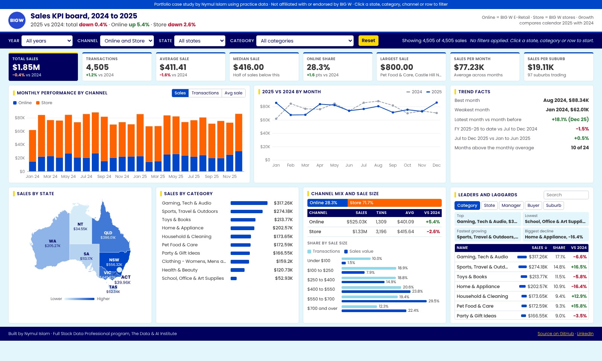

# BIG W Sales KPI Board

An interactive, one-page sales dashboard for a BIG W retail case study. It analyses 4,505 transactions from January 2024 to December 2025 so a leadership team can see every key KPI, filter it and drill into it on one screen.

**🔗 Live dashboard: https://nymul-seam.github.io/bigw-sales-kpi-dashboard/**

[](https://nymul-seam.github.io/bigw-sales-kpi-dashboard/)

> Portfolio case study using practice data. It is not affiliated with or endorsed by BIG W, and the figures are not real BIG W results.

---

## Business problem

Total sales on their own don't tell leaders where the business is growing or shrinking. The brief was to build one screen that answers:

- Are sales growing year on year, and through which channel (Online or Store)?
- Which states, categories, managers, buyers and suburbs lead or lag?
- How are transaction sizes spread, and which sizes bring in the revenue?

## Key findings

| KPI | Result |
|---|---|
| Total sales | $1.85M from 4,505 transactions |
| Average sale | $411.41 (median $416) |
| Calendar 2025 vs 2024 | −0.4% overall |
| Online vs Store growth | Online +5.4%, Store −2.6% |
| Online share of sales | 28.3% |
| Top states | NSW 30% and VIC 24% of sales |
| Top category | Gaming, Tech & Audio ($317K) |

**Insight:** sales look flat overall, but that hides a channel shift. Online is growing while Store is shrinking. A retailer seeing this would review where it puts stock, staff and marketing spend.

## What the dashboard does

- **8 headline KPIs:** total sales, transactions, average sale, median sale, Online share, largest sale, sales per month and sales per suburb, each with its 2025 vs 2024 change.
- **Slicers:** financial year, channel, state and category. Every number and chart updates instantly.
- **Click to filter:** click a state on the Australia map, a category bar, a channel or any table row to filter the whole board. Click it again, or remove its pill, to clear it.
- **Monthly chart:** switch between sales, transactions and average sale, split Online vs Store.
- **2025 vs 2024 by month:** a line for each year, with the change on hover.
- **Trend facts:** best and weakest month, month-on-month change, FY to date vs last year, and second half vs first half of 2025.
- **Channel mix and sale-size bands:** share of transactions vs share of revenue.
- **Leaders and laggards:** a sortable, searchable table by category, state, manager, buyer or suburb, with the top, lowest, fastest-growing and biggest-falling names.
- **Branding:** follows the BIG W brand guidelines supplied for training: Poppins type, Ocean Twilight blue, Navy, Blaze Orange and Bright Gold.

## Data and preparation

- **Source:** `BigW - Sales Dashboard - Data.xlsx` (practice data), 4,505 rows and 13 columns.
- **Quality checks:** no blank values, no duplicate rows, and every financial year label matched its date.
- **Preparation:**
  - Renamed `BIGW E-RETAIL` to **Online** and `BIGW STORE` to **Store**.
  - Added a **Month** column and an Australian **Financial Year** (July to June, for example FY 2024-25).
- **Growth method:** growth compares calendar 2025 with calendar 2024, because those are the only two full years in the data. FY 2023-24 and FY 2025-26 each cover only six months.
- **Clean data:** available in [`bigw_sales_clean.csv`](bigw_sales_clean.csv).

## Tools

HTML, CSS, JavaScript · D3.js v7 (charts, map and data aggregation) · Excel (data review) · AI-assisted development with Claude · GitHub Pages (hosting)

## Repository structure

```
bigw-sales-kpi-dashboard/
├── index.html                  # the whole dashboard in one file (data, charts, fonts and logo built in)
├── README.md                   # this file
├── screenshot.png              # preview image
└── bigw_sales_clean.csv        # the cleaned data, for Excel or Power BI
```

`index.html` is fully self-contained: the cleaned data, the D3.js library, the Poppins font, the logo and the map outlines are all embedded in it, so there are no extra folders to upload.

## Run it on your own computer

Download `index.html` and double-click it. It opens in your browser with all filters working, and no internet connection is needed.

## Credits

- Map outlines: simplified from the [world-geojson](https://github.com/georgique/world-geojson) package.
- Charts: [D3.js](https://d3js.org) (ISC licence).
- Font: [Poppins](https://fonts.google.com/specimen/Poppins) (SIL Open Font Licence).

## Author

**Nymul Islam**, Operations Data Analyst, The Data & AI Institute · Hobart, Tasmania

- LinkedIn: https://www.linkedin.com/in/md-nymul-islam
- GitHub: https://github.com/nymul-seam
